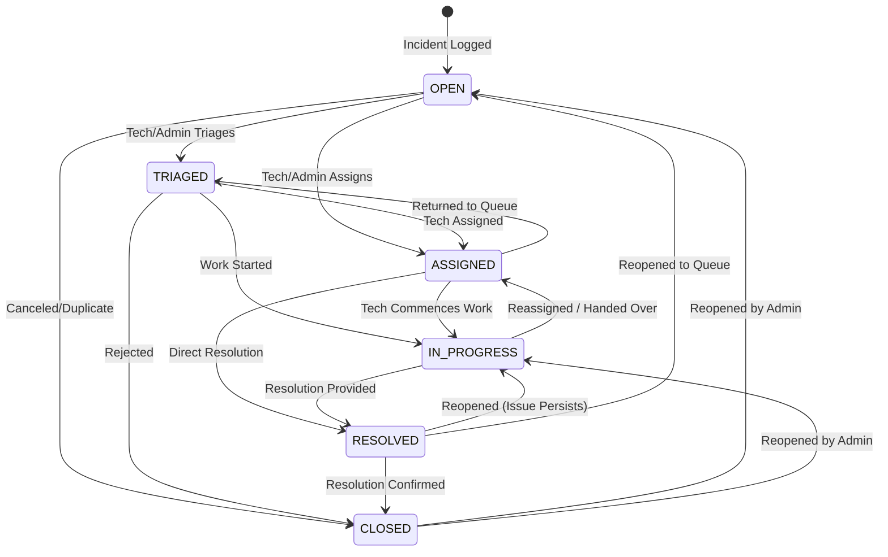

# REST API Specification
**Project:** IT Incident Management and Resolution System  
**Version:** 1.0.0 (Phase 2 Implemented)  
**Base URL:** `http://localhost:8080/api/v1`  
**Authentication Scheme:** HTTP Bearer Authentication (JWT)  

---

## 1. Overview & General Standards

All API responses follow consistent JSON wrapping:
- **Successful Responses:** Wrapped in `ApiResponse<T>` with `success: true`, `message`, `data`, and `timestamp`.
- **Paginated Responses:** Wrapped in `PagedResponse<T>` containing `content`, `page`, `size`, `totalElements`, `totalPages`, and `last`.
- **Error Responses:** Wrapped in `ErrorResponse` containing `status`, `error`, `message`, `path`, `timestamp`, and optional `validationErrors` map.

### Standard HTTP Status Codes
- `200 OK` - Request succeeded.
- `201 Created` - Resource successfully created.
- `400 Bad Request` - Payload validation failed (includes field-level error map).
- `401 Unauthorized` - Missing, invalid, or expired JWT token.
- `403 Forbidden` - Authenticated user lacks required role/permission.
- `404 Not Found` - Requested resource does not exist.
- `409 Conflict` - Resource conflict (e.g. duplicate username or email).
- `500 Internal Server Error` - Unhandled server exception.

---

## 2. Authentication Endpoints (`/api/v1/auth`)

### 2.1 User Login
Authenticates an employee, technician, or administrator and issues a signed JWT token.
- **Method / URL:** `POST /api/v1/auth/login`
- **Security:** Public (`permitAll`)
- **Request Headers:** `Content-Type: application/json`
- **Request Body:**
  ```json
  {
    "username": "jane.doe",
    "password": "SecurePassword123!"
  }
  ```
- **Validation Rules:**
  - `username`: Required, non-blank (accepts username or email).
  - `password`: Required, non-blank.
- **Success Response (`200 OK`):**
  ```json
  {
    "success": true,
    "message": "User authenticated successfully",
    "data": {
      "token": "eyJhbGciOiJIUzI1NiJ9...",
      "tokenType": "Bearer",
      "expiresInMs": 86400000,
      "user": {
        "id": 1,
        "username": "jane.doe",
        "email": "jane.doe@example.com",
        "fullName": "Jane Doe",
        "department": "Engineering",
        "role": "ROLE_EMPLOYEE",
        "isActive": true,
        "createdAt": "2026-10-16T15:00:00Z"
      }
    },
    "timestamp": "2026-10-16T15:00:01Z"
  }
  ```
- **Error Response (`401 Unauthorized`):**
  ```json
  {
    "status": 401,
    "error": "Unauthorized",
    "message": "Invalid username or password",
    "path": "/api/v1/auth/login",
    "timestamp": "2026-10-16T15:00:01Z"
  }
  ```

---

### 2.2 User Self-Registration
Allows new employees to create an account. Defaults strictly to `ROLE_EMPLOYEE`.
- **Method / URL:** `POST /api/v1/auth/register`
- **Security:** Public (`permitAll`)
- **Request Body:**
  ```json
  {
    "username": "alex.smith",
    "email": "alex.smith@example.com",
    "password": "Password876!",
    "fullName": "Alex Smith",
    "department": "Finance"
  }
  ```
- **Validation Rules:**
  - `username`: 3-50 chars, required.
  - `email`: Valid RFC email format, required.
  - `password`: Minimum 8 characters, required.
  - `fullName`: 2-100 chars, required.
- **Success Response (`201 Created`):**
  ```json
  {
    "success": true,
    "message": "User registered successfully",
    "data": {
      "token": "eyJhbGciOiJIUzI1NiJ9...",
      "tokenType": "Bearer",
      "expiresInMs": 86400000,
      "user": {
        "id": 2,
        "username": "alex.smith",
        "email": "alex.smith@example.com",
        "fullName": "Alex Smith",
        "department": "Finance",
        "role": "ROLE_EMPLOYEE",
        "isActive": true,
        "createdAt": "2026-10-16T15:05:00Z"
      }
    },
    "timestamp": "2026-10-16T15:05:01Z"
  }
  ```
- **Error Response (`409 Conflict`):**
  ```json
  {
    "status": 409,
    "error": "Conflict",
    "message": "Username 'alex.smith' is already taken",
    "path": "/api/v1/auth/register",
    "timestamp": "2026-10-16T15:05:01Z"
  }
  ```

---

## 3. User & Profile Endpoints (`/api/v1/users`)

All endpoints in this section require:
`Authorization: Bearer <JWT>`

### 3.1 Get Current User Profile
Returns the profile of the currently authenticated principal.
- **Method / URL:** `GET /api/v1/users/me`
- **Security:** Any authenticated user (`ROLE_EMPLOYEE`, `ROLE_TECHNICIAN`, `ROLE_ADMIN`)
- **Success Response (`200 OK`):**
  ```json
  {
    "success": true,
    "message": "Operation successful",
    "data": {
      "id": 1,
      "username": "jane.doe",
      "email": "jane.doe@example.com",
      "fullName": "Jane Doe",
      "department": "Engineering",
      "role": "ROLE_EMPLOYEE",
      "isActive": true,
      "createdAt": "2026-10-16T15:00:00Z"
    },
    "timestamp": "2026-10-16T15:10:00Z"
  }
  ```

---

### 3.2 Change Password
Updates the password for the currently authenticated user.
- **Method / URL:** `PUT /api/v1/users/me/password`
- **Security:** Any authenticated user
- **Request Body:**
  ```json
  {
    "currentPassword": "OldPassword123!",
    "newPassword": "BrandNewSecret888!"
  }
  ```
- **Validation Rules:**
  - `currentPassword`: Non-blank.
  - `newPassword`: Minimum 8 characters.
- **Success Response (`200 OK`):**
  ```json
  {
    "success": true,
    "message": "Password changed successfully",
    "data": null,
    "timestamp": "2026-10-16T15:12:00Z"
  }
  ```

---

### 3.3 List Users (Paginated)
Lists all user accounts with pagination and sorting.
- **Method / URL:** `GET /api/v1/users?page=0&size=10&sortBy=id&direction=ASC`
- **Security:** Restricted to `ROLE_ADMIN` and `ROLE_TECHNICIAN`. (Employees receive `403 Forbidden`).
- **Query Parameters:**
  - `page` (int, default `0`)
  - `size` (int, default `10`)
  - `sortBy` (string, default `id`)
  - `direction` (string: `ASC` or `DESC`, default `ASC`)
- **Success Response (`200 OK`):**
  ```json
  {
    "success": true,
    "message": "Operation successful",
    "data": {
      "content": [
        {
          "id": 1,
          "username": "admin",
          "email": "admin@example.com",
          "fullName": "System Administrator",
          "department": "IT Operations",
          "role": "ROLE_ADMIN",
          "isActive": true,
          "createdAt": "2026-10-16T12:00:00Z"
        }
      ],
      "page": 0,
      "size": 10,
      "totalElements": 1,
      "totalPages": 1,
      "last": true
    },
    "timestamp": "2026-10-16T15:15:00Z"
  }
  ```

---

### 3.4 Get User by ID
- **Method / URL:** `GET /api/v1/users/{id}`
- **Security:** `ROLE_ADMIN`, `ROLE_TECHNICIAN`, or self (when principal ID matches `{id}`).
- **Success Response (`200 OK`):**
  ```json
  {
    "success": true,
    "message": "Operation successful",
    "data": {
      "id": 1,
      "username": "jane.doe",
      "email": "jane.doe@example.com",
      "fullName": "Jane Doe",
      "department": "Engineering",
      "role": "ROLE_EMPLOYEE",
      "isActive": true,
      "createdAt": "2026-10-16T15:00:00Z"
    },
    "timestamp": "2026-10-16T15:18:00Z"
  }
  ```

---

### 3.5 Administrator User Provisioning
Enables administrators to create new accounts with arbitrary roles (`ROLE_EMPLOYEE`, `ROLE_TECHNICIAN`, `ROLE_ADMIN`).
- **Method / URL:** `POST /api/v1/users/admin`
- **Security:** Restricted strictly to `ROLE_ADMIN`. (All other users receive `403 Forbidden`).
- **Request Body:**
  ```json
  {
    "username": "tech.carlos",
    "email": "carlos@example.com",
    "password": "Password777!",
    "fullName": "Carlos Technician",
    "department": "Hardware Triage",
    "role": "ROLE_TECHNICIAN"
  }
  ```
- **Success Response (`201 Created`):**
  ```json
  {
    "success": true,
    "message": "User created successfully by Administrator",
    "data": {
      "id": 3,
      "username": "tech.carlos",
      "email": "carlos@example.com",
      "fullName": "Carlos Technician",
      "department": "Hardware Triage",
      "role": "ROLE_TECHNICIAN",
      "isActive": true,
      "createdAt": "2026-10-16T15:20:00Z"
    },
    "timestamp": "2026-10-16T15:20:01Z"
  }
  ```

---

## 4. System Health Endpoint (`/api/v1/health`)

- **Method / URL:** `GET /api/v1/health`
- **Security:** Public (`permitAll`)
- **Success Response (`200 OK`):**
  ```json
  {
    "status": "UP",
    "service": "IT Incident Management and Resolution System - Backend",
    "timestamp": "2026-10-16T15:25:00Z",
    "version": "0.0.1-SNAPSHOT",
    "javaVersion": "21.0.12.1"
  }
  ```

---

## 5. Core Incident Management Endpoints (`/api/v1/incidents`)

All endpoints in this section require:
`Authorization: Bearer <JWT>`

### 5.1 Business Rules & Reference Tables

#### Impact & Urgency Priority Matrix (ITIL Standard)
The priority of an incident is calculated automatically from `impact` and `urgency`:

| Impact \ Urgency | `HIGH` | `MEDIUM` | `LOW` |
| :--- | :---: | :---: | :---: |
| **`HIGH`** | **`CRITICAL`** | **`HIGH`** | **`MEDIUM`** |
| **`MEDIUM`** | **`HIGH`** | **`MEDIUM`** | **`LOW`** |
| **`LOW`** | **`MEDIUM`** | **`LOW`** | **`LOW`** |

- If the client omits `priority`, the server automatically calculates it.
- If the client supplies a `priority` that contradicts the matrix, the server rejects the request with HTTP `400 Bad Request`.

#### Incident Status Lifecycle & Transition Matrix



**Reopening Rules:**
- `RESOLVED` incidents can be reopened to `IN_PROGRESS` or `OPEN` by the reporting Employee, a Technician, or an Admin.
- `CLOSED` incidents can be reopened strictly by `ROLE_ADMIN`. Technicians and Employees attempting to reopen a closed incident receive HTTP `403 Forbidden`.
- Transitioning to `RESOLVED` strictly requires `resolutionNotes` (provided in request or already on incident).

---

### 5.2 Create Incident
Creates a new incident with server-side ticket number generation (`INC-YYYYMMDD-XXXX`), automatically records authenticated reporter, calculates priority from impact/urgency, associates the corresponding SLA policy, and sets status to `OPEN`.
- **Method / URL:** `POST /api/v1/incidents`
- **Security:** Authenticated (`ROLE_EMPLOYEE`, `ROLE_TECHNICIAN`, `ROLE_ADMIN`)
- **Request Body:**
  ```json
  {
    "title": "Primary VPN Gateway Unreachable",
    "description": "Unable to connect to internal services via corporate VPN.",
    "categoryId": 3,
    "impact": "HIGH",
    "urgency": "HIGH",
    "priority": "CRITICAL"
  }
  ```
- **Validation Rules:**
  - `title`: Required, 3-200 characters.
  - `description`: Required, non-blank.
  - `categoryId`: Required, must reference an existing incident category.
  - `impact`: Required (`LOW`, `MEDIUM`, `HIGH`).
  - `urgency`: Required (`LOW`, `MEDIUM`, `HIGH`).
  - `priority`: Optional; if supplied, must match matrix calculation.
- **Success Response (`201 Created`):**
  ```json
  {
    "success": true,
    "message": "Incident created successfully",
    "data": {
      "id": 1,
      "ticketNumber": "INC-20261017-7B9X",
      "title": "Primary VPN Gateway Unreachable",
      "description": "Unable to connect to internal services via corporate VPN.",
      "impact": "HIGH",
      "urgency": "HIGH",
      "priority": "CRITICAL",
      "status": "OPEN",
      "category": {
        "id": 3,
        "name": "Network & VPN",
        "description": "Wi-Fi, LAN, firewall, DNS, or VPN connectivity interruptions",
        "slaHours": 2
      },
      "reporter": {
        "id": 10,
        "username": "jane.doe",
        "email": "jane.doe@example.com",
        "fullName": "Jane Doe",
        "role": "ROLE_EMPLOYEE"
      },
      "assignee": null,
      "slaPolicy": {
        "id": 1,
        "name": "Critical Incident SLA",
        "priority": "CRITICAL",
        "responseTimeHours": 1,
        "resolutionTimeHours": 4
      },
      "resolutionNotes": null,
      "createdAt": "2026-10-17T12:00:00Z",
      "updatedAt": "2026-10-17T12:00:00Z",
      "resolvedAt": null
    },
    "timestamp": "2026-10-17T12:00:01Z"
  }
  ```
- **Error Responses:**
  - `400 Bad Request`: Field validation error or contradictory priority.
  - `401 Unauthorized`: Missing or invalid JWT.
  - `404 Not Found`: Category ID does not exist.

---

### 5.3 List Incidents (Paginated & Filtered)
Returns a paginated list of incidents with optional filtering by status, priority, category, search keyword, reporter, and assignee.
- **Method / URL:** `GET /api/v1/incidents?page=0&size=10&sortBy=createdAt&direction=DESC&status=OPEN&priority=CRITICAL`
- **Security:**
  - `ROLE_EMPLOYEE`: Restricted strictly to own incidents (`reporter_id == principal.id`).
  - `ROLE_TECHNICIAN`, `ROLE_ADMIN`: May view all incidents and filter by any attribute.
- **Query Parameters:**
  - `page` (int, default `0`)
  - `size` (int, default `10`)
  - `sortBy` (string, default `createdAt`)
  - `direction` (`ASC` or `DESC`, default `DESC`)
  - `status` (optional `IncidentStatus`: `OPEN`, `TRIAGED`, `ASSIGNED`, `IN_PROGRESS`, `RESOLVED`, `CLOSED`)
  - `priority` (optional `Priority`: `LOW`, `MEDIUM`, `HIGH`, `CRITICAL`)
  - `categoryId` (optional `Long`)
  - `search` (optional `String`: searches title, ticket number, and description)
  - `reporterId` (optional `Long`)
  - `assigneeId` (optional `Long`)
- **Success Response (`200 OK`):**
  ```json
  {
    "success": true,
    "message": "Operation successful",
    "data": {
      "content": [
        {
          "id": 1,
          "ticketNumber": "INC-20261017-7B9X",
          "title": "Primary VPN Gateway Unreachable",
          "priority": "CRITICAL",
          "status": "OPEN",
          "category": { "id": 3, "name": "Network & VPN" },
          "reporter": { "id": 10, "username": "jane.doe" },
          "assignee": null,
          "createdAt": "2026-10-17T12:00:00Z"
        }
      ],
      "page": 0,
      "size": 10,
      "totalElements": 1,
      "totalPages": 1,
      "last": true
    },
    "timestamp": "2026-10-17T12:05:00Z"
  }
  ```

---

### 5.4 Get Incident Details
Retrieves complete incident information by ID.
- **Method / URL:** `GET /api/v1/incidents/{id}`
- **Security:**
  - `ROLE_EMPLOYEE`: Permitted only if the employee is the reporter (`403 Forbidden` otherwise).
  - `ROLE_TECHNICIAN`, `ROLE_ADMIN`: Permitted for all incidents.
- **Success Response (`200 OK`):** Detailed `IncidentResponse` object.
- **Error Responses:** `401 Unauthorized`, `403 Forbidden`, `404 Not Found`.

---

### 5.5 Update Incident Fields
Updates permitted incident fields.
- **Method / URL:** `PUT /api/v1/incidents/{id}`
- **Security:**
  - `ROLE_EMPLOYEE`: Permitted to update `title` and `description` only while the incident is in `OPEN` or `TRIAGED` status. Forbidden once work is `IN_PROGRESS` or ticket is `RESOLVED`/`CLOSED`. Forbidden from updating category, impact, or urgency.
  - `ROLE_TECHNICIAN`, `ROLE_ADMIN`: Permitted to update `title`, `description`, `categoryId`, `impact`, and `urgency`. Modifying impact or urgency recalculates priority and SLA policy.
- **Request Body:**
  ```json
  {
    "title": "Primary VPN Gateway Down - Failover Timeout",
    "description": "Secondary tunnel also fails after 15 seconds.",
    "impact": "HIGH",
    "urgency": "HIGH"
  }
  ```
- **Success Response (`200 OK`):** Updated `IncidentResponse`.

---

### 5.6 Status Transition
Performs a validated status transition along with an optional transition reason and mandatory resolution notes when transitioning to `RESOLVED`.
- **Method / URL:** `PATCH /api/v1/incidents/{id}/status`
- **Security:**
  - `ROLE_EMPLOYEE`: May only cancel own open ticket (`OPEN` -> `CLOSED`), confirm resolution (`RESOLVED` -> `CLOSED`), or reopen resolved ticket (`RESOLVED` -> `IN_PROGRESS` or `OPEN`).
  - `ROLE_TECHNICIAN`: May perform any valid transition except reopening `CLOSED` tickets.
  - `ROLE_ADMIN`: May perform all valid transitions including reopening `CLOSED` tickets.
- **Request Body:**
  ```json
  {
    "status": "RESOLVED",
    "reason": "Replaced routing table config on core gateway",
    "resolutionNotes": "BGP route dampening reset and failover verified."
  }
  ```
- **Validation Rules:**
  - `status`: Required valid enum value.
  - `resolutionNotes`: Required when `status` is `RESOLVED`.
- **Success Response (`200 OK`):** Updated `IncidentResponse`.
- **Error Responses:**
  - `400 Bad Request`: Invalid transition (e.g. `OPEN` -> `RESOLVED`) or missing resolution notes.
  - `403 Forbidden`: Unauthorized role for this transition.

---

### 5.7 Assign Incident
Assigns or reassigns an incident to an active IT Support Technician.
- **Method / URL:** `PATCH /api/v1/incidents/{id}/assignment`
- **Security:** Restricted to `ROLE_TECHNICIAN` and `ROLE_ADMIN`. (`ROLE_EMPLOYEE` receives `403 Forbidden`).
- **Request Body:**
  ```json
  {
    "assigneeId": 20,
    "notes": "Assigning to Network Tier 2 support team lead."
  }
  ```
- **Validation Rules:**
  - `assigneeId`: Required, must correspond to an active user with `ROLE_TECHNICIAN` or `ROLE_ADMIN`.
- **Behavior:**
  - If ticket is currently `OPEN` or `TRIAGED`, status is automatically transitioned to `ASSIGNED`.
  - Records previous assignee, new assignee, assigning user, notes, and timestamp in `incident_assignments`.
  - Emits audit log entry.
- **Success Response (`200 OK`):** Updated `IncidentResponse`.

---

### 5.8 Incident History & Audit Trail
Retrieves comprehensive status change history, assignment history, and compliance audit events.
- **Method / URL:** `GET /api/v1/incidents/{id}/history`
- **Security:**
  - `ROLE_EMPLOYEE`: Allowed only for own incidents (`403 Forbidden` otherwise).
  - `ROLE_TECHNICIAN`, `ROLE_ADMIN`: Allowed for all incidents.
- **Success Response (`200 OK`):**
  ```json
  {
    "success": true,
    "message": "Operation successful",
    "data": {
      "incidentId": 1,
      "ticketNumber": "INC-20261017-7B9X",
      "statusHistory": [
        {
          "id": 2,
          "oldStatus": "OPEN",
          "newStatus": "ASSIGNED",
          "changedBy": { "username": "charlie.tech" },
          "changeReason": "Auto-transitioned upon assignment",
          "createdAt": "2026-10-17T12:15:00Z"
        },
        {
          "id": 1,
          "oldStatus": null,
          "newStatus": "OPEN",
          "changedBy": { "username": "jane.doe" },
          "changeReason": "Incident created",
          "createdAt": "2026-10-17T12:00:00Z"
        }
      ],
      "assignmentHistory": [
        {
          "id": 1,
          "assignedBy": { "username": "charlie.tech" },
          "previousAssignee": null,
          "assignedTo": { "username": "dan.tech" },
          "assignmentNotes": "Assigning to Network Tier 2",
          "assignedAt": "2026-10-17T12:15:00Z"
        }
      ],
      "auditEvents": [
        {
          "id": 3,
          "action": "INCIDENT_ASSIGNMENT_CHANGED",
          "performedBy": { "username": "charlie.tech" },
          "previousState": "UNASSIGNED",
          "newState": "dan.tech",
          "createdAt": "2026-10-17T12:15:00Z"
        }
      ]
    },
    "timestamp": "2026-10-17T12:20:00Z"
  }
  ```

---

### 5.9 List Incident Comments & Work Notes
Returns the chronological discussion thread for an incident.
- **Method / URL:** `GET /api/v1/incidents/{id}/comments`
- **Security & Confidentiality Rules:**
  - `ROLE_EMPLOYEE`: Allowed only on own incidents. Returns **strictly public comments** (`isInternal == false`). Internal work notes are filtered out on the backend and never transmitted.
  - `ROLE_TECHNICIAN`, `ROLE_ADMIN`: Returns all comments including internal technician work notes.
- **Success Response (`200 OK`):**
  ```json
  {
    "success": true,
    "message": "Operation successful",
    "data": [
      {
        "id": 1,
        "incidentId": 1,
        "author": { "username": "jane.doe", "fullName": "Jane Doe" },
        "commentText": "Attached ping and traceroute logs.",
        "internal": false,
        "createdAt": "2026-10-17T12:02:00Z"
      },
      {
        "id": 2,
        "incidentId": 1,
        "author": { "username": "dan.tech", "fullName": "Dan Tech" },
        "commentText": "INTERNAL: Core router switchover initiated in rack 4.",
        "internal": true,
        "createdAt": "2026-10-17T12:18:00Z"
      }
    ],
    "timestamp": "2026-10-17T12:22:00Z"
  }
  ```

---

### 5.10 Add Comment or Internal Work Note
Adds a new comment or internal technician work note to the incident thread.
- **Method / URL:** `POST /api/v1/incidents/{id}/comments`
- **Security & Authorization Rules:**
  - `ROLE_EMPLOYEE`: May only add public comments (`isInternal: false`) to own incidents. Supplying `isInternal: true` returns HTTP `403 Forbidden`.
  - `ROLE_TECHNICIAN`, `ROLE_ADMIN`: May add public comments or internal work notes (`isInternal: true`).
- **Request Body:**
  ```json
  {
    "commentText": "Core router rebooted; please test VPN connection now.",
    "isInternal": false
  }
  ```
- **Validation Rules:**
  - `commentText`: Required, non-blank.
- **Success Response (`201 Created`):**
  ```json
  {
    "success": true,
    "message": "Comment added successfully",
    "data": {
      "id": 3,
      "incidentId": 1,
      "author": { "username": "dan.tech", "fullName": "Dan Tech" },
      "commentText": "Core router rebooted; please test VPN connection now.",
      "internal": false,
      "createdAt": "2026-10-17T12:30:00Z"
    },
    "timestamp": "2026-10-17T12:30:01Z"
  }
  ```
- **Error Responses:**
  - `400 Bad Request`: Blank comment text.
  - `401 Unauthorized`: Unauthenticated.
  - `403 Forbidden`: Employee attempting to create internal work note or comment on another's incident.
  - `404 Not Found`: Incident ID not found.

