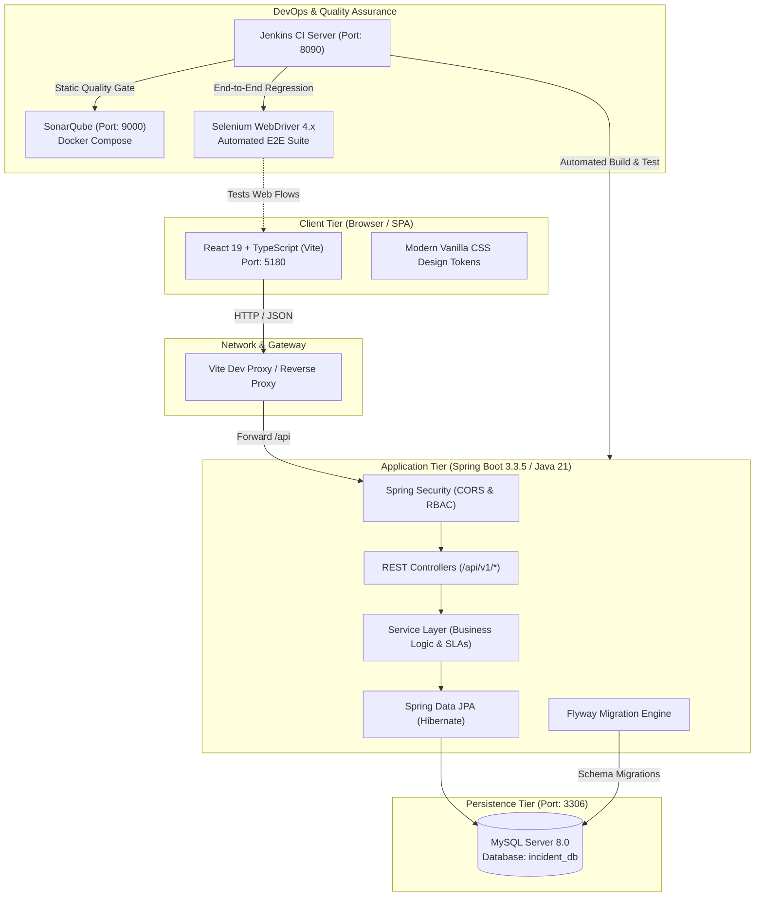
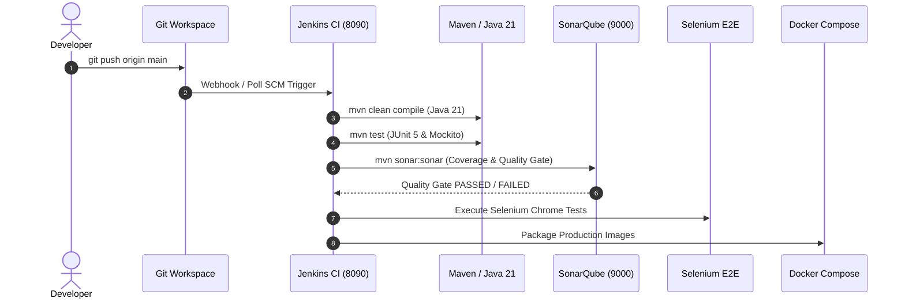

# System Architecture & DevOps Pipeline Specification
**Project:** IT Incident Management and Resolution System  
**Document Version:** 1.0.0  
**Status:** Approved for Implementation  

---

## 1. High-Level Architectural Blueprint

The system follows an **enterprise multi-tier decoupled architecture** designed for high cohesion, low coupling, maintainability, and end-to-end auditability.

---

## 2. Layered Responsibilities

### 2.1 Presentation Layer (Frontend)
- **Role:** Single Page Application (SPA) providing an intuitive, accessible service desk UI.
- **Technology:** React 19, TypeScript, Vite.
- **Style System:** Modern Vanilla CSS with high-contrast glassmorphism, responsive CSS grid, and semantic priority color tokens (`--priority-low`, `--priority-medium`, `--priority-high`, `--priority-critical`).
- **Communication:** Typed REST API calls via standard `fetch` or Axios with automatic base path routing (`/api/v1/`).

### 2.2 Controller & Security Layer
- **Role:** Exposes secure REST endpoints, validates incoming JSON payloads using `@Valid` bean validation, and handles cross-origin requests.
- **Technology:** Spring Web, Spring Security 6.x.
- **Security Strategy:** Stateless session management with RBAC authorization:
  - `ROLE_ADMIN`: User management, category configuration, system metrics, SLA policy editing.
  - `ROLE_AGENT`: Triage, assignment, status transitions, internal notes, resolution recording.
  - `ROLE_USER`: Ticket creation, personal incident tracking, public comment thread interaction.

### 2.3 Service & Domain Layer
- **Role:** Enforces business constraints, priority assignment, SLA countdowns, notification dispatch, and state transition validation.
- **Transactions:** Declarative `@Transactional` boundaries ensuring atomic database modifications.
- **Audit Logging:** Every state change emits an immutable audit event recorded in `incident_audit_logs`.

### 2.4 Persistence Layer
- **Role:** High-performance relational persistence using MySQL 8.0 InnoDB engine with UTF-8 (`utf8mb4`) encoding.
- **ORM:** Spring Data JPA with Hibernate. Schema changes are strictly governed by versioned Flyway migrations (`db/migration/V*`). Direct `hibernate.ddl-auto=update` is prohibited in production.

---

## 3. DevOps & Continuous Integration Pipeline

The CI/CD pipeline runs on the host **Jenkins** instance (`http://localhost:8090`) triggered on code repository commits:

### Pipeline Stages
1. **Checkout:** Pulls verified source code from the repository.
2. **Compile:** Verifies bytecode compilation using Java 21 LTS and Maven 3.9+.
3. **Unit & Integration Tests:** Executes JUnit 5 and Mockito test suites using isolated H2 in-memory databases.
4. **Code Quality Analysis:** Sends AST and test execution data to SonarQube Community Edition (`localhost:9000`). Checks for code smells, vulnerabilities, security hotspots, and test coverage thresholds.
5. **E2E Acceptance Testing:** Launches headless Chrome via Selenium 4.x to validate critical user journeys (login, ticket creation, ticket status change).
6. **Package & Containerize:** Produces optimized JAR and Docker container artifacts.
