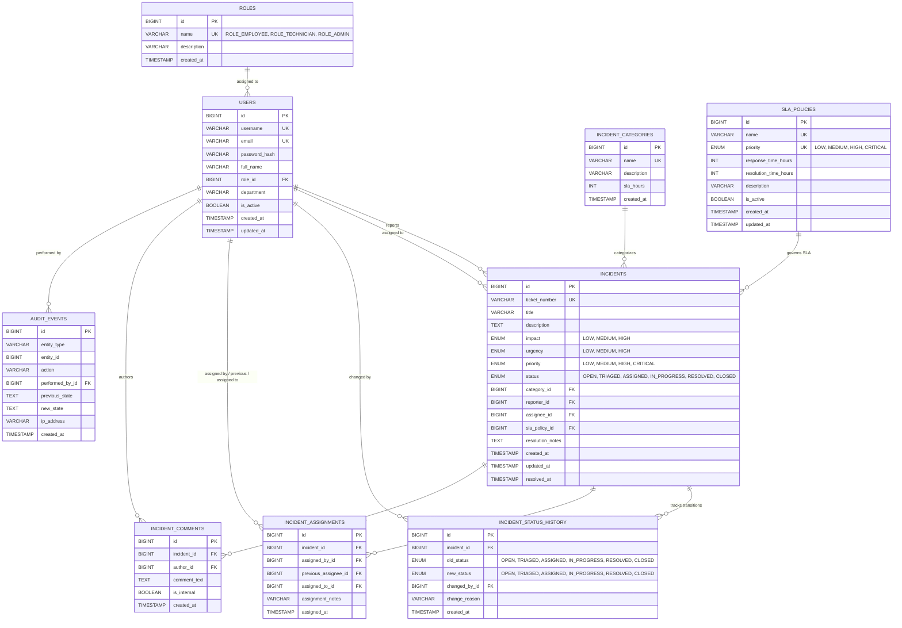

# Database Design & Schema Specification
**Project:** IT Incident Management and Resolution System  
**Engine:** MySQL Server 8.0 (InnoDB)  
**Character Set:** `utf8mb4`  
**Collation:** `utf8mb4_unicode_ci`  
**Migration Tool:** Flyway (`classpath:db/migration`)  
**Status:** Schema Defined & Verified via Flyway/JPA on isolated H2; host MySQL pending user approval.

---

## 1. Entity-Relationship (ER) Diagram

---

## 2. Table Specifications & Normalization

### 2.1 `roles`
Stores access control profiles. Seeded with:
- `ROLE_ADMIN` (Full administrative & configuration access)
- `ROLE_TECHNICIAN` (Triage, work notes, reassignments, resolutions)
- `ROLE_EMPLOYEE` (Ticket submission, status tracking, public comments)

### 2.2 `users`
User accounts mapped to roles. Passwords stored strictly as BCrypt hashes (`password_hash`).
- Constraints: Unique `username`, Unique `email`, Foreign Key `role_id` -> `roles.id`.

### 2.3 `sla_policies`
Formal Service Level Agreement policies mapped to incident priority levels.
- `priority`: ENUM (`LOW`, `MEDIUM`, `HIGH`, `CRITICAL`), unique.
- `response_time_hours`: Hours allowed before initial technician response.
- `resolution_time_hours`: Hours allowed before incident resolution.

### 2.4 `incident_categories`
IT service catalog categorization.
- Seeded with: Hardware, Software & OS, Network & VPN, Security & Access, Database & Infrastructure.

### 2.5 `incidents`
Core transactional incident entity.
- `ticket_number`: Unique human-readable ticket code (`INC-YYYYMMDD-XXXX`).
- `impact`: ENUM (`LOW`, `MEDIUM`, `HIGH`).
- `urgency`: ENUM (`LOW`, `MEDIUM`, `HIGH`).
- `priority`: ENUM (`LOW`, `MEDIUM`, `HIGH`, `CRITICAL`), determined strictly by the impact-and-urgency matrix.
- `status`: ENUM (`OPEN`, `TRIAGED`, `ASSIGNED`, `IN_PROGRESS`, `RESOLVED`, `CLOSED`), defaulting to `OPEN`.
- Foreign keys: `category_id`, `reporter_id`, `assignee_id`, `sla_policy_id`.
- Indexes: `idx_incidents_status`, `idx_incidents_priority`, `idx_incidents_ticket`, `idx_incidents_reporter`, `idx_incidents_assignee`, `idx_incidents_category`, `idx_incidents_created_at`.

### 2.6 `incident_status_history`
Maintains an immutable historical record of every status transition (`OPEN` -> `TRIAGED` -> `ASSIGNED` -> `IN_PROGRESS` -> `RESOLVED` -> `CLOSED`), recording timestamp, actor, and transition reason.

### 2.7 `incident_assignments`
Tracks assignment history, including the assigning user, previous assignee (`previous_assignee_id`), new assignee (`assigned_to_id`), timestamp, and assignment handover notes.
- Foreign keys: `fk_assign_incident`, `fk_assign_by`, `fk_assign_prev`, `fk_assign_to`.

### 2.8 `incident_comments`
Discussion thread attached to incidents. Supports:
- Public comments (`is_internal = FALSE`): Visible to the reporting employee.
- Internal work notes (`is_internal = TRUE`): Visible only to technicians and administrators.
- Indexes: `idx_comments_incident`, `idx_comments_created`.

### 2.9 `audit_events`
General compliance audit log recording actions across all domain entities (e.g., `INCIDENT_CREATED`, `INCIDENT_STATUS_CHANGED`, `INCIDENT_ASSIGNMENT_CHANGED`, `COMMENT_ADDED`, `INTERNAL_NOTE_ADDED`).
- Indexes: `idx_audit_entity`, `idx_audit_created`.

---

## 3. Flyway Migration Version History

### 3.1 Migration `V1__initial_schema.sql`
- Creates foundational tables: `roles`, `users`, `sla_policies`, `incident_categories`, `incidents`, `incident_status_history`, `incident_assignments`, `incident_comments`, `audit_events`.
- Seeds standard system roles (`ROLE_EMPLOYEE`, `ROLE_TECHNICIAN`, `ROLE_ADMIN`).
- Seeds default SLA policies (`CRITICAL`, `HIGH`, `MEDIUM`, `LOW`).
- Seeds standard IT categories.

### 3.2 Migration `V2__incident_management.sql`
- Extends `incidents` with `impact` and `urgency` ENUM columns (`LOW`, `MEDIUM`, `HIGH`).
- Upgrades `status` ENUM in `incidents` and `incident_status_history` to support full Phase 3 lifecycle: `OPEN`, `TRIAGED`, `ASSIGNED`, `IN_PROGRESS`, `RESOLVED`, `CLOSED`.
- Extends `incident_assignments` with `previous_assignee_id` referencing `users(id)` with `ON DELETE SET NULL`.
- Adds performance indexes: `idx_incidents_reporter`, `idx_incidents_assignee`, `idx_incidents_category`, `idx_incidents_created_at`, `idx_comments_created`.

---

## 4. Host Database Verification & Safe Migration Strategy

- **Host MySQL Server Status:** Running on port `3306` (`MySQL80` Windows service). Root authentication requires credentials.
- **Data Protection Policy:** No databases (`CREATE DATABASE`), users, or schemas have been created or modified on the host MySQL instance.
- **Test Isolation:** All automated unit and integration tests run strictly against an in-memory H2 database (`jdbc:h2:mem:testdb;MODE=MySQL`).
- **Production Migrations:** Stored in `backend/src/main/resources/db/migration` (`V1__initial_schema.sql`, `V2__incident_management.sql`) for controlled execution via Flyway upon user approval.
