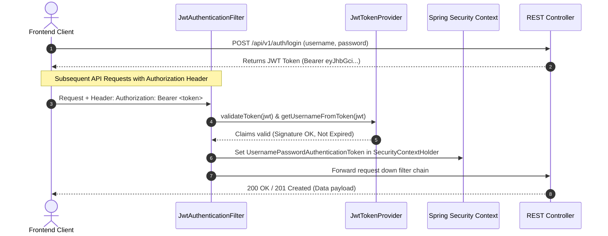

# Security Architecture & Access Control Specification
**Project:** IT Incident Management and Resolution System  
**Document Version:** 1.1.0 (Phase 3 Implemented)  
**Security Model:** Role-Based Access Control (RBAC) & Object-Level Access Control (OLAC) with Stateless JWT Authentication  

---

## 1. Authentication Architecture

The system implements a stateless, token-based authentication mechanism using **JSON Web Tokens (JWT)** and **Spring Security 6.x**.



### 1.1 Password Security & Hashing
- **Algorithm:** `BCryptPasswordEncoder` configured with work factor / cost `12`.
- **Salts:** Automatically generated unique random 128-bit salts embedded per password hash (`$2a$12$...`).
- **Resilience:** Protects against rainbow tables and brute force attacks.
- **DTO Safety:** Password hashes are excluded from all outgoing DTOs (`UserSummaryDto`), eliminating accidental data leakage in API responses.

### 1.2 Cryptographic Token Specifications
- **Signing Algorithm:** HMAC-SHA256 (`HS256`).
- **Key Derivation:** Cryptographically verified 256-bit secret key decoded from Base64 or byte-padded (`Keys.hmacShaKeyFor`).
- **Token Claims Payload:**
  - `sub`: Username (principal)
  - `userId`: Internal database identifier
  - `email`: User email address
  - `fullName`: Display name
  - `role`: Assigned role authority (`ROLE_EMPLOYEE`, `ROLE_TECHNICIAN`, `ROLE_ADMIN`)
  - `iat`: Issue timestamp
  - `exp`: Expiration timestamp (default: 24 hours / 86,400,000 ms)
- **Token Validation:** Verified on every request for signature integrity, expiration, format validity, and non-empty claims.

---

## 2. Role-Based Access Control (RBAC) Matrix

Permissions are strictly enforced on the **backend** using Spring Security method security (`@EnableMethodSecurity(prePostEnabled = true)` and `@PreAuthorize` annotations), ensuring frontend tampering cannot bypass security boundaries.

| Resource / Endpoint | HTTP Method | `ROLE_EMPLOYEE` | `ROLE_TECHNICIAN` | `ROLE_ADMIN` | Unauthenticated |
| :--- | :---: | :---: | :---: | :---: | :---: |
| `/api/v1/health` | GET | Allowed | Allowed | Allowed | Allowed |
| `/api/v1/auth/login` | POST | Allowed | Allowed | Allowed | Allowed |
| `/api/v1/auth/register` | POST | Allowed (defaults to Employee) | Allowed (defaults to Employee) | Allowed (defaults to Employee) | Allowed |
| `/api/v1/users/me` | GET | **Allowed** | **Allowed** | **Allowed** | **Denied (401)** |
| `/api/v1/users/me/password` | PUT | **Allowed** | **Allowed** | **Allowed** | **Denied (401)** |
| `/api/v1/users` (List) | GET | **Forbidden (403)** | **Allowed** | **Allowed** | **Denied (401)** |
| `/api/v1/users/{id}` | GET | Self only (or 403) | **Allowed** | **Allowed** | **Denied (401)** |
| `/api/v1/users/admin` (Provision) | POST | **Forbidden (403)** | **Forbidden (403)** | **Allowed** | **Denied (401)** |
| `/api/v1/incidents` (Create) | POST | **Allowed** | **Allowed** | **Allowed** | **Denied (401)** |
| `/api/v1/incidents` (List) | GET | **Own incidents only** | **All incidents & queues** | **All incidents & queues** | **Denied (401)** |
| `/api/v1/incidents/{id}` (Get) | GET | **Own incident only** | **Allowed** | **Allowed** | **Denied (401)** |
| `/api/v1/incidents/{id}` (Update) | PUT | **Own & OPEN/TRIAGED only** | **Allowed** | **Allowed** | **Denied (401)** |
| `/api/v1/incidents/{id}/status` | PATCH | **Close own / Reopen resolved** | **Allowed (except CLOSED)** | **Full transitions & reopen CLOSED** | **Denied (401)** |
| `/api/v1/incidents/{id}/assignment` | PATCH | **Forbidden (403)** | **Allowed (to Technician)** | **Allowed (to Technician)** | **Denied (401)** |
| `/api/v1/incidents/{id}/history` | GET | **Own incident only** | **Allowed** | **Allowed** | **Denied (401)** |
| `/api/v1/incidents/{id}/comments` | GET | **Own public comments only** | **All (Public & Internal)** | **All (Public & Internal)** | **Denied (401)** |
| `/api/v1/incidents/{id}/comments` | POST | **Public comments on own** | **Public & Internal Notes** | **Public & Internal Notes** | **Denied (401)** |

---

## 3. Object-Level Access Control (OLAC) & Confidentiality

### 3.1 Employee Ownership Isolation
- An employee can never retrieve, update, comment on, or view the history of an incident reported by another user.
- Even if an employee knows the ID or ticket number of another employee's incident, the backend checks:
  ```java
  if (currentUser.getRole().getName() == RoleName.ROLE_EMPLOYEE &&
      !incident.getReporter().getId().equals(currentUser.getId())) {
      throw new AccessDeniedException("Access denied: You are not authorized to view this incident.");
  }
  ```
- In paginated queries (`GET /api/v1/incidents`), the backend injects an immutable JPA specification predicate `cb.equal(root.get("reporter").get("id"), currentUser.getId())` for employees, overriding any client-supplied query parameters.

### 3.2 Client-Supplied Attribute Sanitization
- The backend **never trusts** client-supplied IDs for:
  - `reporter_id`: Injected strictly from the authenticated principal in the Spring Security context.
  - `changed_by_id`: Injected from the authenticated principal on status updates.
  - `assigned_by_id`: Injected from the authenticated principal on assignments.
  - `author_id`: Injected from the authenticated principal on comments.
  - `performed_by_id`: Injected from the authenticated principal in audit events.

### 3.3 Internal Technician Work Notes Confidentiality
- IT Support Technicians and Administrators frequently record sensitive internal notes (e.g., diagnostic logs, security vulnerability details, vendor RMA numbers, technician triage opinions).
- **Read Protection:** When an employee calls `GET /api/v1/incidents/{id}/comments`, the query executes `commentRepository.findByIncidentIdAndIsInternalFalseOrderByCreatedAtAsc(id)`. Internal notes are physically filtered at the persistence layer and are never transmitted over the wire to employees.
- **Write Protection:** If an employee attempts to send `"isInternal": true` to `POST /api/v1/incidents/{id}/comments`, the backend explicitly rejects the request with HTTP `403 Forbidden` (`Employees are not authorized to create internal work notes`).

### 3.4 Status Machine & Reopening Governance
- An employee can withdraw/cancel their own open ticket (`OPEN` -> `CLOSED`), confirm a resolution (`RESOLVED` -> `CLOSED`), or reopen a resolved ticket if the issue persists (`RESOLVED` -> `IN_PROGRESS` or `OPEN`).
- Employees and Technicians cannot reopen an incident once permanently `CLOSED`. Reopening a closed incident is strictly restricted to `ROLE_ADMIN`.

---

## 4. Security Filter Chain & Handlers

1. **Stateless Session Management:**
   - `SessionCreationPolicy.STATELESS` ensures no server-side HTTP session cookies are created or stored.
2. **CORS Configuration:**
   - Explicitly restricts allowed origins to trusted frontend URLs (`http://localhost:5180`, `http://localhost:5173`, `http://localhost:3000`).
   - Allowed methods: `GET`, `POST`, `PUT`, `DELETE`, `PATCH`, `OPTIONS`.
3. **Custom Security Entry Points:**
   - `JwtAuthenticationEntryPoint`: Intercepts unauthenticated requests and returns a structured RFC-compliant JSON response with HTTP 401 (`status: 401`, `error: "Unauthorized"`).
   - `CustomAccessDeniedHandler`: Intercepts requests with insufficient role authorities and returns structured JSON with HTTP 403 (`status: 403`, `error: "Forbidden"`).

---

## 5. Secret & Credential Management Policy

- **Zero Hard-Coded Secrets:** All sensitive credentials (`JWT_SECRET`, `DB_PASSWORD`, `DB_USERNAME`) are loaded from environment variables or `.env`.
- **Repository Safety:** The root `.gitignore` excludes `.env`, `*.key`, `*.pem`, and all IDE configuration folders.
- **Fail-Safe Defaults:** Development fallbacks are provided for local development, while production configurations require explicitly supplied environment variables.
